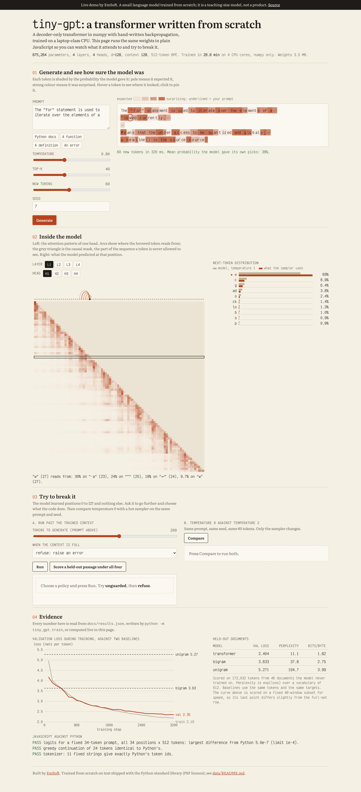
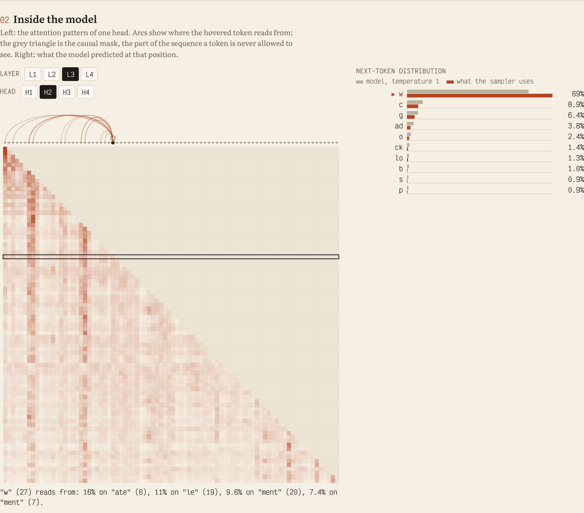
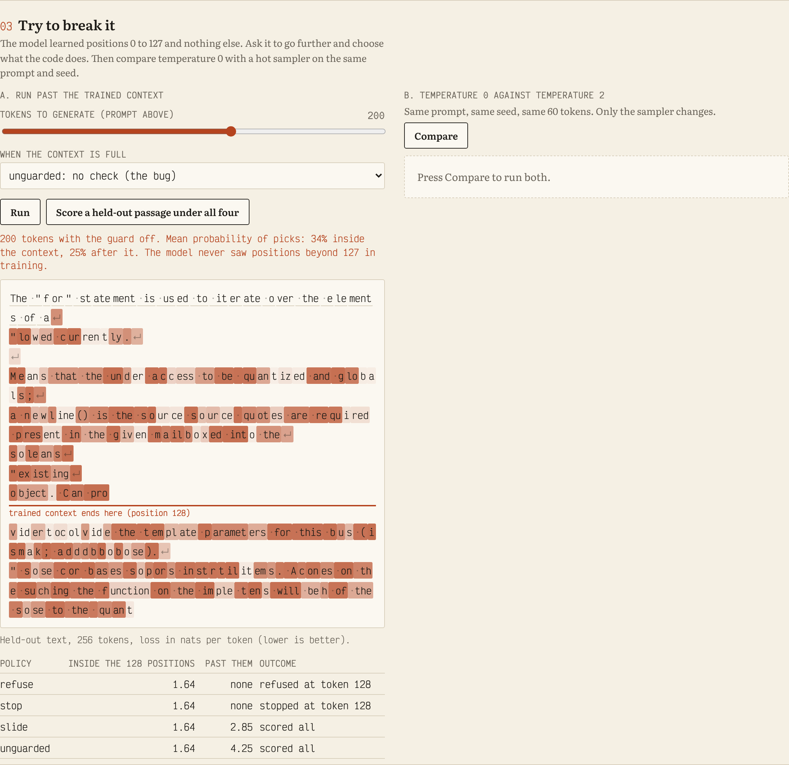

# tiny-gpt: a transformer written from scratch, with its attention made visible

A small decoder-only language model in plain numpy, with every layer's backpropagation written by hand and checked against finite differences. The same weights run in your browser in plain JavaScript, so you can see what the model attends to and try to break it.

**▶ Live demo: https://enxo7899.github.io/transformer-from-scratch/** (press Generate, then hover a token)



## What it does

| Capability | Detail |
|---|---|
| Tokenizer | Byte-level BPE trained from scratch, 512 tokens, exact round trip on any string |
| Model | Token + learned position embeddings, 4 pre-LayerNorm blocks, 4-head causal attention, GELU MLP, tied output head (875,264 parameters) |
| Training | Hand-written forward and backward, AdamW, cosine schedule with warmup, gradient clipping, seeded, CPU only |
| Gradient checks | Every layer and the whole model compared with central finite differences in float64 |
| Browser | Same forward pass in JavaScript with a KV cache, temperature and top-k sampling, seeded |
| Attention viewer | Pick a layer and head, hover a token: arcs and a heat map with the causal mask drawn in |
| Try to break it | Run past the trained context under four policies; temperature 0 against temperature 2 |
| Parity | The page checks its logits, tokenizer and greedy output against Python on every load |

## Measured results

Held-out documents (46 documents, 172,032 tokens), same tokens and targets for all three. Source: `docs/results.json`, produced by `python -m tiny_gpt.train`.

| Model | Val loss (nats/token) | Perplexity | Bits per byte |
|---|---|---|---|
| Transformer | 2.404 | 11.1 | 1.82 |
| Bigram (smoothed) | 3.633 | 37.8 | 2.75 |
| Unigram | 5.271 | 194.7 | 3.99 |

Trained for 3,200 steps (batch 16 x 128 tokens, about 6.6M tokens) in 28.8 minutes on 4 CPU cores. The corpus is Python standard-library documentation, about 4 MB (see `data/README.md`). The model writes text that sounds like those docs but wanders; it is a teaching-size model.



## How it works

```
 corpus ─► split by document ─► BPE ─► token ids
                                          │
   numpy model (float32) ◄── AdamW, cosine LR, clipping
   forward + hand-written backward
   tests: finite differences in float64
                                          │
        model/weights.bin  tokenizer.json  parity.json  docs/results.json
                                          │
   web/model.js (same maths, KV cache) ─► page: chips, attention, bars, curve
   node --test checks it against Python's logits to 1e-4
```

Details and trade-offs are in `docs/DESIGN.md`. The model has learned positions 0 to 127 only, so both implementations raise `ContextOverflowError` past that. The page lets you choose refuse, stop, slide (forget the oldest half) or unguarded, and scores a held-out passage under each so you can see the cost of removing the check.



## Limits

- Teaching size: under a million parameters and 4 MB of text. Output is fluent-looking fragments, not reliable answers.
- Validation documents come from the same source as training (Python docs), so the numbers say nothing about other kinds of text.
- Training took 28.8 minutes, longer than the 25 I aimed for; other work was running on the same machine part of the time.
- Perplexity is the only quality metric. There is no task evaluation.
- The JavaScript forward pass is written for clarity; a 128-token pass takes a few hundred milliseconds.
- Learned absolute positions give a hard context limit of 128 tokens.

## Run it

```bash
pip install -e ".[dev]"      # numpy only at runtime, pytest for tests
npm test                      # pytest (gradient checks, BPE, causality, ...) then node --test (JS parity)
npm run dev                   # http://127.0.0.1:5187/
npm run train                 # about 29 minutes on 4 cores; rewrites model/ and docs/results.json
python -m tiny_gpt.export     # rewrite model/parity.json after retraining
npm run screenshots           # needs the dev server running; Playwright installed globally
python3 data/build_corpus.py  # rebuild the corpus from the local Python installation
```

Sample text from Python: `python -c "from tiny_gpt.weights import load_weights; from tiny_gpt.bpe import BPETokenizer; from tiny_gpt.infer import generate; m=load_weights('model/weights.bin'); t=BPETokenizer.load('model/tokenizer.json'); print(t.decode(generate(m, t.encode('A decorator is a function that'), 60, 0.8, 40, seed=1)))"`

## Adapt it to your business

Replace `data/corpus.txt` (documents separated by a `<<<DOC>>>` line) with your own text, then run `npm run train` and `python -m tiny_gpt.export`. Change model size with flags such as `--layers`, `--dim` and `--context`. The page picks up the new weights and results on its own. For a real product you would want far more data and a larger model; `docs/DESIGN.md` lists what I would change.

---
Built by **[EmSoft](https://github.com/enxo7899)**: Python and machine-learning engineering, from model code to a working demo. Get in touch through my Fiverr or Upwork profile.
